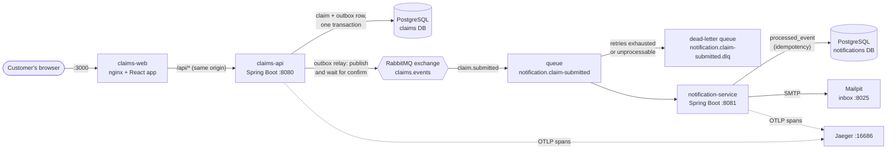

# Claims Portal

[](https://github.com/Daneomac/claims-portal/actions/workflows/ci.yml)

A home insurance claim portal, built as a take-home challenge for a Software Developer III role at
Red River Mutual. A customer fills in a React form. A Spring Boot API validates the claim, stores
it with a unique claim number, and publishes a `ClaimSubmitted` event to RabbitMQ using a
transactional outbox. A **separate** notification service consumes the event and emails the
customer their claim number. Everything runs locally with one `docker compose` command, with
traces in Jaeger, JSON logs and Prometheus metrics, and is covered by unit, integration,
component and end-to-end tests that also run in GitHub Actions.

**Where to look:** [demo script](#demo-script) · [architecture](#architecture) ·
[design plan](docs/PLAN.md) · [decision records](docs/adr/README.md) · [event contract](docs/events.md)

## Requirements and where they are met

The challenge's scope table, in its own order. The first column's tag is the challenge's.

| Area | Where it is met |
|---|---|
| **Web application** (required): a customer form with input validation and a clear confirmation | [`claims-web/`](claims-web): React + TypeScript + Vite. Collects name, email and phone, policy number, date and type of loss, a description, and the property address. Inline errors plus an error summary, and a "Claim received" confirmation that shows the claim number and tells the customer to check their email. Accessibility is tested with axe. No file upload (optional in the challenge, not built) |
| **Backend API** (required): validate, process, unique claim number | [`claims-api/`](claims-api): `POST /api/v1/claims`, Bean Validation plus domain rules, claim numbers like `HC-2026-000123` from a database sequence ([PLAN §4](docs/PLAN.md#4-claims-api)) |
| **Asynchronous event flow** (required): publish Claim Submitted; a separate subscriber handles it | Transactional outbox and relay publish to RabbitMQ ([ADR 0001](docs/adr/0001-rabbitmq-message-broker.md), [0002](docs/adr/0002-transactional-outbox.md)); [`notification-service/`](notification-service) is a separate app with its own database. Contract: [docs/events.md](docs/events.md) |
| **Email notification** (required): the consumer generates and sends the email, with the claim number | notification-service renders Thymeleaf HTML and text and sends them over SMTP to Mailpit. The claims API never sends email. Demo step 4 |
| **Automated tests** (required) | [Running the tests](#running-the-tests): about 250 tests across unit, integration, contract, component and end-to-end levels |
| **Containerization** (required) | Dockerfiles for the three apps and [`docker-compose.yml`](docker-compose.yml) with every supporting component ([Containers](#containers-and-local-orchestration)) |
| **Persistence** (required) | PostgreSQL 17 with Flyway migrations; one database per service |
| **CI/CD** (optional) | [`.github/workflows/ci.yml`](.github/workflows/ci.yml): build and test both services and the web app, then the end-to-end tests against the Compose stack. Dependabot for updates. **Packaging and deployment are not done:** CI doesn't publish images |
| **Cloud deployment** (optional) | **Not done.** The stack runs locally with Compose only. How it would be deployed is in [Deploying it](#deploying-it) |
| **Observability** (optional) | Health and readiness probes, ECS JSON logs with trace IDs, Prometheus metrics, and one trace per claim across both services and the broker in Jaeger ([PLAN §9](docs/PLAN.md#9-observability)). No dashboards: nothing scrapes the metrics yet |

**Optional enhancements:** retries, dead-letter handling and idempotency are built and demonstrated
(demo steps 7 and 8, [ADR 0003](docs/adr/0003-at-least-once-idempotent-consumer.md),
[0004](docs/adr/0004-retry-and-dead-letter.md)); integration and end-to-end tests are included; and
there is accessibility work on the form.

**Deliverables:** the code is in this repository; prerequisites, build, run, test and demo
instructions are in [Prerequisites](#prerequisites) to [Running the tests](#running-the-tests);
the architecture overview is [below](#architecture); the container setup is
[Containers and local orchestration](#containers-and-local-orchestration); the AI statement is
[at the end](#ai-assisted-development). The challenge also asks for the design to be
defensible: [Key design decisions](#key-design-decisions-and-trade-offs),
[Security and customer data](#security-and-customer-data) and
[What I'd add for production](#what-id-add-for-production) cover that.

## Architecture



**What happens when a claim is submitted**

1. The browser posts the form to `/api/v1/claims`. nginx forwards it to claims-api.
2. claims-api validates it, saves the claim, and writes the `ClaimSubmitted` event to an
   `outbox_event` table **in the same database transaction**. The customer gets `201` and the
   claim number straight away, even if RabbitMQ is down.
3. A relay in claims-api polls the outbox every 500 ms, publishes each event to RabbitMQ with
   publisher confirms, and marks it published only once the broker acknowledges it.
4. notification-service receives the event. In one transaction it records the event ID (so a
   duplicate is skipped) and sends the email. If sending fails it retries with back-off, then
   dead-letters the message.
5. The email lands in Mailpit. The same trace ID is on every step, from the HTTP request to the
   email.

### Components

| Component | What it does | Stack |
|---|---|---|
| [`claims-web`](claims-web) | One-page claim form and confirmation. nginx serves it, proxies `/api`, sets security headers and rate-limits | React 19, TypeScript, Vite, react-hook-form, zod; nginx (unprivileged) |
| [`claims-api`](claims-api) | Validates and stores claims, owns the outbox and the `claims.events` exchange | Java 25, Spring Boot 4.1.1, JPA, Flyway, Spring AMQP |
| [`notification-service`](notification-service) | Idempotent consumer: renders and sends the confirmation email, retries, dead-letters | Java 25, Spring Boot 4.1.1, Spring AMQP, Thymeleaf, Jakarta Mail |
| PostgreSQL | One database and one login per service (`claims`, `notifications`), so neither can read the other's tables | PostgreSQL 17 |
| RabbitMQ | Event broker with the management UI | RabbitMQ 4.3 |
| Mailpit | Catches all outgoing email; web inbox and REST API | Mailpit |
| Jaeger | Trace viewer (traces are kept in memory) | Jaeger v2 |

`claims-api` and `notification-service` are separate Maven projects with no shared code. They
agree on the event only through the [contract](docs/events.md) (ADR 0005). Inside each service
the packages are layered (`web`/`messaging` → `application` → `domain`/`persistence`, with
`infrastructure` on the outside) and an ArchUnit test enforces the dependency direction.

## Prerequisites

**To run the stack** (everything below): Docker Desktop, or any Docker engine with Compose v2.1+
(`docker compose up --wait` needs it). That's all: the images build the Java and Node apps
themselves. Give Docker a few GB of memory (each Java app is capped at 768 MB). These host ports
must be free: 3000, 8080, 8081, 5432, 5672, 15672, 1025, 8025 and 16686.

**To run the tests or develop outside containers:** JDK 25 and Node.js 24+. Maven is not needed:
each Java project includes the Maven wrapper (`./mvnw`, or `mvnw.cmd` in Windows `cmd`/PowerShell).
The Java tests start their own Postgres, RabbitMQ and Mailpit containers (Testcontainers), so
Docker must be running for them too. The end-to-end tests also need Chromium, installed by
Playwright (see below).

The commands in this README are for a Unix-style shell (Git Bash works on Windows). Where
PowerShell differs, it says so.

## Quick start

```bash
cp .env.example .env                  # PowerShell: Copy-Item .env.example .env
docker compose up --build -d --wait   # builds the three apps, starts everything, returns when all are healthy
```

The first build downloads Maven and npm dependencies and takes a few minutes; later builds reuse
cached layers. Then open http://localhost:3000, submit a claim, and find the email in Mailpit at
http://localhost:8025.

| What | URL | Notes |
|---|---|---|
| Claim form | http://localhost:3000 | claims-web (nginx). `/api/*` is proxied to claims-api |
| claims-api | http://localhost:8080 | Also published directly for curl. `POST /api/v1/claims`; health at `/actuator/health` |
| notification-service | http://localhost:8081/actuator/health | Actuator only, no business endpoints |
| Mailpit inbox | http://localhost:8025 | Every email the stack sends. Kept in memory, so it empties when Mailpit restarts |
| RabbitMQ management | http://localhost:15672 | Log in with `RABBITMQ_USER` / `RABBITMQ_PASSWORD` from `.env` (`claims-portal` / `local-only-rabbitmq` in `.env.example`) |
| Jaeger | http://localhost:16686 | Traces, in memory: gone after `docker compose down` |

```bash
docker compose ps                                        # status and health
docker compose logs -f claims-api notification-service   # follow the logs (JSON, one object per line)
docker compose down                                      # stop; the database and broker data are kept
docker compose down -v                                   # stop and delete the data volumes too
```

To develop outside containers, start only the supporting services with
`docker compose up -d --wait postgres rabbitmq mailpit`, then run each app from your IDE or with
`./mvnw spring-boot:run` (they read the repo-root `.env` and default to `localhost`), and
`npm run dev` in `claims-web` (port 3000, proxying `/api` to `localhost:8080`).

To build without Compose: `./mvnw package` in each Java project and `npm run build` in `claims-web`.

## Demo script

About ten minutes. Start with the stack running and healthy (`docker compose up -d --wait`).
Steps 1–6 are the happy path; 7 and 8 show what happens when things break. I ran every step
against the stack while writing this.

The two sample requests in [`docs/demo/`](docs/demo) are for `curl`. On Windows PowerShell use
`curl.exe` (plain `curl` is an alias for something else). The sample claim's loss date must be
within the last 365 days, so edit it if you run this much later than October 2026.

**1. Validation errors.** Open http://localhost:3000 and press **Submit claim** on the empty
form. An error summary ("There is a problem") takes focus and lists every missing field, each a
link to its input; each field also shows its own message. Nothing is sent to the API. Fix one
field and its error clears. The server validates too, and is the authority:

```bash
curl -i -X POST http://localhost:3000/api/v1/claims -H "Content-Type: application/json" -d @docs/demo/invalid-claim.json
```

This returns `400` with an RFC 9457 problem body and an `errors` array of `{field, message}`,
the paths the form maps back onto its inputs. Every response carries an `X-Trace-Id` header.

**2. Submit.** Fill in the form (any valid data; the date of loss is limited to the past year)
and press **Submit claim**. The button disables while the request is in flight.

**3. Confirmation.** The form is replaced by "Claim received" with the claim number (like
`HC-2026-000016`) and the address the confirmation went to.

**4. The email.** Open Mailpit at http://localhost:8025. A message "We've received your claim
HC-…" is there within about a second, addressed to the email you entered, with the same claim
number, the loss type and date, and the policy number masked (`RRM-****5678`). It has both an
HTML and a plain-text part, and no damage description.

**5. The message flow in RabbitMQ.** Open http://localhost:15672 and log in. Under **Exchanges**,
`claims.events` (a durable topic exchange) has a binding to `notification.claim-submitted` with
routing key `claim.submitted`. Under **Queues**, `notification.claim-submitted` and its
`.dlq` are both empty, because the consumer takes each message at once; submit a few claims and
watch the publish and ack rates on the queue's chart. (To see a message sit in a queue, do step 8.)

**6. One trace, and the same trace ID in the logs.** Submit a claim with curl so you can see the
header:

```bash
curl -i -X POST http://localhost:3000/api/v1/claims -H "Content-Type: application/json" -d @docs/demo/valid-claim.json
```

Copy the `X-Trace-Id` value. (The form's request has the same header in the browser's network
tab.) Open `http://localhost:16686/trace/<trace id>` in Jaeger. One trace, five spans, across
two services: `http post /api/v1/claims`, `outbox publish`, `claims.events/claim.submitted send`,
`notification.claim-submitted receive` and `send confirmation email`. The outbox span starts
about half a second after the request: that's the relay's polling delay, and the trace is still
connected because the trace context is stored on the outbox row.

Now find the same ID in both services' logs:

```bash
docker compose logs --no-log-prefix claims-api notification-service | grep <trace id>
```

(PowerShell: `docker compose logs --no-log-prefix claims-api notification-service | Select-String <trace id>`.)
Each service writes JSON (Elastic Common Schema) with `traceId` and `spanId`, so you will see
lines from claims-api (the claim saved, the event published) and from notification-service (the
email sent) with one ID. None of them contains a name or email address.

**7. Resilience: the broker goes down.**

```bash
docker compose stop rabbitmq
```

Submit a claim in the browser. It still succeeds and shows a claim number: the claim and its
event are committed to the database, and publishing is a separate step. Check the backlog and the
relay's warnings:

```bash
curl -s http://localhost:8080/actuator/prometheus | grep ^outbox_pending     # 1.0 (the unpublished event)
docker compose logs --tail 5 claims-api                                      # "Could not publish outbox event ... (failed attempts: N)"
```

Mailpit has no new email. Now bring the broker back:

```bash
docker compose start rabbitmq
```

Within about half a minute `outbox_pending` goes back to `0.0` and the email appears in Mailpit.
Nothing was lost and nothing was sent twice.

**8. The dead-letter queue.** Stop the mail server and submit a claim:

```bash
docker compose stop mailpit
docker compose logs -f notification-service
```

The claim is accepted and published. The consumer can't send the email: you'll see four
`Could not send the confirmation for claim HC-…` warnings, spaced by the back-off (1 s, 2 s, 4 s
plus SMTP timeouts, so 15 to 30 seconds in all), then
`Giving up on event … It goes to the dead-letter queue notification.claim-submitted.dlq`. The
logs hold only the event ID, claim number and exception type, never the message body. (Press
Ctrl+C to stop following.) In RabbitMQ, **Queues** → `notification.claim-submitted.dlq` now has
one message. Under **Get messages**, leave the ack mode on "Nack message requeue true" and press
**Get Message(s)** to see the properties (`message_id`, the original `traceparent` header, an
`x-death` header saying why) and the JSON payload. `notifications_failed_total` on
`http://localhost:8081/actuator/prometheus` is 1.

Fix the cause and replay it, as described in [ADR 0004](docs/adr/0004-retry-and-dead-letter.md):

1. `docker compose start mailpit`.
2. In RabbitMQ: **Exchanges** → `claims.events` → **Publish message**. Routing key
   `claim.submitted`; payload: the JSON you copied from the DLQ, unchanged; optionally the
   property `message_id` = the event's ID.
3. The email arrives in Mailpit. Back on the DLQ, **Get messages** with ack mode "Automatic ack"
   removes the old copy.

Replaying twice is harmless: the consumer ignores an event ID it has already handled.

**To reset:** `docker compose down -v` deletes all the data, including the claim sequence.

## Running the tests

| Suite | Command | Needs | Tests (at time of writing) |
|---|---|---|---|
| claims-api | `cd claims-api && ./mvnw verify` | JDK 25, Docker | 80 |
| notification-service | `cd notification-service && ./mvnw verify` | JDK 25, Docker | 52 |
| claims-web | `cd claims-web && npm ci && npm test` | Node 24+ | 116 |
| End to end | see below | Node 24+, Docker, the stack running | 5 |

`npm run typecheck` and `npm run lint` (oxlint) in `claims-web` are part of CI too. On Windows,
use `mvnw.cmd` for `./mvnw`. The Java suites start Postgres, RabbitMQ and Mailpit containers
themselves, so the first run pulls those images; the Compose stack doesn't need to be running.

| Level | Where | What it proves, and the most important cases |
|---|---|---|
| Unit | claims-api `domain`, `application` | Each validation rule at its boundary (loss date today, tomorrow, 365 and 366 days ago, in Winnipeg time); claim number format; address and policy normalisation. Submitting saves the claim **and** its outbox event; nothing is queued if the save fails |
| Web slice | claims-api `@WebMvcTest` | `201` with the claim number; `400` problem details with field paths; malformed JSON gives `400` with no internals; unexpected errors give a generic `500`; personal data never reaches the log |
| Integration | claims-api + Postgres and RabbitMQ containers | Submit stores a claim and an outbox row; the relay publishes a message with the right properties, and its body matches the contract fixture; **broker paused: the API still accepts claims, then publishes them after recovery**; nothing bound to the exchange: the message is returned and stays pending; trace context carries from request to message |
| Unit and integration | notification-service | Email has the claim number, the escaped first name, a masked policy number; **the same event twice sends one email**; a concurrent duplicate waits for the first, then skips; unknown version or non-JSON body goes straight to the DLQ; **SMTP down: four attempts, then the DLQ, nothing recorded as processed**; no personal data in logs; metrics counters exist |
| Contract | both services | The producer's published body must equal `contracts/claim-submitted-v1.json`; the consumer parses a copy of that file and ignores unknown fields ([docs/events.md](docs/events.md)) |
| Architecture | both Java services (ArchUnit) | Layers depend only inwards; the domain has no Spring or JPA imports |
| Component | claims-web (Vitest, Testing Library, MSW) | Required-field errors with focus on the summary; each field rule; success shows the claim number and sends the API's JSON shape; the button is disabled while pending; a server `400` maps to fields; a `500` or network error shows a banner and keeps the data |
| End to end | `e2e/` (Playwright, Chromium) | A real browser fills in the form, sees a claim number, and the email in Mailpit contains **the same** claim number; the empty form shows errors and calls no API; axe finds no serious or critical accessibility violations on the form, the error state and the confirmation |

The end-to-end suite is the automated version of the demo, run against the real containers:

```bash
docker compose up --build -d --wait   # the stack must be running
cd e2e
npm ci
npx playwright install chromium       # first time only (add --with-deps on a fresh Linux machine)
npm test
npm run report                        # HTML report with traces and screenshots of failures
```

It expects the form at http://localhost:3000 and Mailpit at http://localhost:8025 (override with
`BASE_URL` and `MAILPIT_URL`). It leaves its test claims in the database.

**CI.** [`ci.yml`](.github/workflows/ci.yml) runs on every push and pull request: claims-api,
notification-service and claims-web in parallel, then, if all three pass, the `e2e` job brings up
the Compose stack from a clean checkout (using `.env.example`) and runs Playwright. On failure it
uploads the Playwright report and the Compose logs. The token is read-only, and a newer push
cancels the older run. [Dependabot](.github/dependabot.yml) opens weekly PRs for Maven, npm,
Docker, Compose and Actions, grouped by minor and patch; major versions are ignored for
everything except Actions (see [PLAN §11](docs/PLAN.md#11-cicd-github-actions)).

## Containers and local orchestration

`docker compose up --build -d --wait` starts seven containers ([`docker-compose.yml`](docker-compose.yml)):
`postgres`, `rabbitmq`, `mailpit`, `jaeger`, `claims-api`, `notification-service` and `claims-web`.

- **Startup order is real, not hoped for.** Each service has a healthcheck, and `depends_on:
  condition: service_healthy` waits for it: databases and broker first, then the two apps (probing
  `/actuator/health/readiness`), then nginx. `--wait` returns when everything is healthy.
- **Java images** (multi-stage): a JDK build stage, then a JRE-only Alpine image with the Spring Boot
  jar split into layers (dependencies, loader, snapshot, application), so a code change rebuilds
  one small layer. They run as a non-root user, with the JVM heap sized from the container's
  768 MB limit, and `java` as PID 1 so it receives `SIGTERM` for a graceful shutdown.
- **Web image:** Node builds the static site; unprivileged nginx serves it. nginx sets the security
  headers, proxies `/api/` to claims-api, limits request size and rate, and returns 404 for
  `/actuator`, so management endpoints are only reachable on the published ports used for the
  demo ([ADR 0006](docs/adr/0006-same-origin-reverse-proxy.md)).
- **Data:** named volumes for Postgres and RabbitMQ. `docker compose down` keeps them;
  `down -v` deletes them. An init script creates one database and one login per service.
- **Configuration** comes from environment variables (next section). `restart: unless-stopped` on
  the apps. Every published port is for the demo; a real deployment would expose only the web
  entry point.
- Details and the reasoning for each choice are in [PLAN §7a](docs/PLAN.md#7a-containers-milestone-6).

## Configuration and secrets

- **No secret is committed.** `.env` is git-ignored. [`.env.example`](.env.example) holds
  obviously local-only values (`local-only-…`) for the five variables Compose needs:
  `POSTGRES_PASSWORD`, `CLAIMS_DB_PASSWORD`, `NOTIFICATIONS_DB_PASSWORD`, `RABBITMQ_USER` and
  `RABBITMQ_PASSWORD`. Compose uses `${VAR:?…}`, so it refuses to start if one is missing.
  CI copies `.env.example` too. `.dockerignore` keeps `.env` out of the images.
- **Each service gets only its own credentials.** claims-api has no `NOTIFICATIONS_DB_PASSWORD`
  and the reverse, and the init script gives each login access to its own database only. The
  Postgres superuser password is used only by the init script.
- **The apps are configured by environment variables,** with nothing secret in
  `application.yml`: `DB_HOST`, `DB_PORT`, `DB_USERNAME`, `RABBITMQ_HOST`, `RABBITMQ_PORT`,
  `SMTP_HOST`, `SMTP_PORT`, `EMAIL_FROM`, plus the passwords above. Compose sets the host names.
  Run from an IDE, they read the repo-root `.env` and default to `localhost`.
- **Behaviour settings** are in each `application.yml`, with comments: claims-api
  (`claims.time-zone`, `claims.max-loss-age-days`, `claims.outbox.*` for poll delay, batch size
  and confirm timeout) and notification-service (`spring.rabbitmq.listener.simple.retry.*`,
  `notifications.email.from`).
- **Observability switches:** `LOGGING_STRUCTURED_FORMAT_CONSOLE=ecs` (JSON logs) and
  `MANAGEMENT_OPENTELEMETRY_TRACING_EXPORT_OTLP_ENDPOINT` (where to send spans) are set only by
  Compose, so IDE and test runs stay readable and need no Jaeger.
- In a real environment the values would come from a secrets manager, not a file.

## Key design decisions and trade-offs

The reasoning, alternatives and consequences are in the [ADRs](docs/adr/README.md); in short:

| Decision | Why, and what it costs |
|---|---|
| **Transactional outbox** ([0002](docs/adr/0002-transactional-outbox.md)) | A claim is never saved without its event, or published without being saved. Costs about 500 ms of polling delay, an extra table to clean up, and at-least-once (not exactly-once) delivery |
| **At-least-once delivery with an idempotent consumer** ([0003](docs/adr/0003-at-least-once-idempotent-consumer.md)) | Duplicates are expected and harmless: one `INSERT … ON CONFLICT DO NOTHING` decides, in the same transaction as the send. One gap remains: a crash after SMTP accepts the message but before the commit sends a second email. A provider-side idempotency key would close it |
| **RabbitMQ** ([0001](docs/adr/0001-rabbitmq-message-broker.md)) | Dead-lettering, confirms, a management UI and Spring support out of the box; Kafka would be heavier than one event needs. No long-term replay |
| **Bounded retries, then a DLQ** ([0004](docs/adr/0004-retry-and-dead-letter.md)) | Transient failures recover and poison messages don't block the queue or vanish. Retrying in the listener holds a consumer thread; per-delay retry queues would avoid that |
| **Event contract per service, no shared library** ([0005](docs/adr/0005-event-contract-per-service.md)) | Services build and deploy independently. Some duplication, and keeping the two fixtures in step is manual |
| **SPA and API on one origin via nginx** ([0006](docs/adr/0006-same-origin-reverse-proxy.md)) | No CORS, one public entry point, security headers in one place |
| **Server-side validation is authoritative;** the zod schema mirrors it for UX | The client can be bypassed; the form still gives instant feedback. The two rule sets have to be kept in step by hand (tests pin the boundaries on both sides) |
| **No `GET /claims/{number}`** | Without authentication it would hand customer data to anyone who guesses a sequential number |
| **A minimal event** (no description, phone or address) | Less personal data spread across the broker, queues and logs; the email doesn't need more |
| **Two databases, one per service** | No shared tables, so each service can change its schema alone. Costs a second set of credentials and migrations |
| **Plain CSS modules and no UI library** | Small and easy to explain; accessibility is handled and tested directly |

## Security and customer data

| Area | What is done |
|---|---|
| Secrets | None in the repo; see [Configuration](#configuration-and-secrets). Per-service database logins |
| Personal data in logs | Logs carry claim numbers, event IDs and trace IDs only. Request and event records override `toString()` to redact names and emails, and tests assert it. Spring AMQP's default recoverer logs the full exception, whose message can quote the customer's email address (an SMTP rejection, for example), so a custom one that logs only the event ID and exception type replaces it ([ADR 0004](docs/adr/0004-retry-and-dead-letter.md)) |
| Personal data elsewhere | The event carries only what the email needs. The email masks the policy number and omits the damage description. Error responses never include stack traces, only a trace ID |
| Input | Every field is validated with length limits; JPA parameter binding; nginx caps request bodies at 16 KB |
| Output | React and Thymeleaf escape by default (a test covers an HTML-escaped first name) |
| Abuse | nginx rate-limits `/api` to 5 requests per second per IP, with a burst of 10 |
| Browser | A strict Content-Security-Policy (no inline script, `frame-ancestors 'none'`), `X-Content-Type-Options`, `X-Frame-Options`, `Referrer-Policy`, `Permissions-Policy` |
| Containers | Non-root users, JRE-only Alpine images, actuator not routed through nginx |
| Supply chain | Dependabot; lockfiles for npm; CI on every push |

This is a demo, not a hardened system: there is no authentication, no TLS, and the broker,
database and admin UIs are published on the host for convenience. See the next section.

## What I'd add for production

**Not built, deliberately** (the scope was one vertical slice, and these are decisions for the
real environment):

- **Customer authentication and policy lookup.** Right now anyone can submit a claim against any
  well-formed policy number. A real system would verify the policyholder, and could then offer
  claim status with proper access control.
- **TLS everywhere** (HSTS at the edge), secrets in a secrets manager, encryption at rest, a data
  retention policy and backups, and a CAPTCHA or similar on the public form.
- **Idempotency on submission.** The button disables while sending, but a retried or double
  `POST` creates two claims. An `Idempotency-Key` header would fix that.
- **Outbox housekeeping:** a scheduled purge of published rows; CDC (for example Debezium) instead
  of polling at higher volume. I tested the relay's `SKIP LOCKED` locking only on a single
  instance, not with several instances running together.
- **Retry and DLQ operations:** per-delay retry queues instead of retrying in the listener; an alert on
  DLQ depth and on `outbox.pending`; a runbook and a tool for bulk replay (the shovel plugin).
- **Email:** a real provider with a per-message idempotency key (this closes the one duplicate-email
  gap), bounce handling, and unsubscribe/legal text.
- **Monitoring:** the metrics are exposed (`/actuator/prometheus`) but nothing scrapes them. Add
  Prometheus and Grafana with alerts; a trace sampling rate below 100%; spans sent to a collector;
  strip or re-validate an incoming `traceparent` at the edge so the public can't choose trace IDs.
- **Contracts and compatibility:** consumer-driven contract tests (Pact) or a schema registry
  instead of two fixture files kept in step by hand.
- **Delivery:** image publishing to a registry, deployment (see [Deploying it](#deploying-it)),
  environments, and a load and failure-injection test for the whole pipeline.
- **Product details:** the claim number sequence doesn't reset each year and numbers are guessable;
  French and other translations; dark mode; claim attachments (photos).

## Deploying it

I didn't deploy this to a cloud environment; it's a local, Compose-based stack. The apps are
already built the way a deployment needs them: stateless containers configured through environment
variables, with readiness probes and graceful shutdown. A no-cost route would be:

- build the three images in CI and push them to GitHub Container Registry;
- run `claims-web`, `claims-api` and `notification-service` on a free container host;
- use a managed free-tier PostgreSQL (two databases or schemas) and a hosted RabbitMQ (for
  example a free CloudAMQP plan), set through the same environment variables;
- replace Mailpit with a transactional email provider's free tier, behind the existing
  `EmailSender` port, and send traces to a hosted collector or leave Jaeger out;
- keep secrets in the host's secrets store, and put TLS in front of nginx.

None of that has been tried, so I'd expect small surprises (connection limits, TLS to the broker,
memory limits on free tiers) rather than design changes.

## Repository layout

```
claims-portal/
├── claims-api/              Spring Boot: REST API, validation, persistence, outbox, publishing
├── notification-service/    Spring Boot: event consumer, idempotency, email, retry and DLQ
├── claims-web/              React + TypeScript claim form; Dockerfile and nginx.conf
├── e2e/                     Playwright tests that run against the Compose stack
├── infra/postgres/          Init script: one database and login per service
├── docs/
│   ├── PLAN.md              Detailed design and build plan
│   ├── events.md            The ClaimSubmitted v1 event contract
│   ├── adr/                 Architecture decision records
│   └── demo/                Sample requests for the demo script
├── .github/                 CI workflow and Dependabot configuration
├── docker-compose.yml       The whole local stack
├── .env.example             Local-only values; copy to .env (git-ignored)
└── README.md
```

## AI-assisted development

I built this with Claude Code (Anthropic) in the Claude desktop app. I used Claude Opus 5.5 for
planning and for the design-heavy milestones (the outbox, the idempotent consumer, retries and
the dead-letter queue, and tracing), and Claude Sonnet 5.5 for the UI, the containers, CI and the
documentation.

I planned the work up front in [docs/PLAN.md](docs/PLAN.md) and the [ADRs](docs/adr/README.md),
then built it one milestone per session, with one commit per milestone (see `git log`).

Each milestone was validated three ways: automated tests; live
runs against the Compose stack (the form-to-email flow, plus broker-down and DLQ checks like demo
steps 7 and 8); and the CI pipeline. Dependabot opened major-version upgrade PRs; I reviewed and
rejected them, and the Postgres 18 one failed CI. I then told Dependabot to ignore major versions.

For secrets: none are committed, `.env` is git-ignored, and the measures are listed under
[Configuration and secrets](#configuration-and-secrets) and
[Security and customer data](#security-and-customer-data).

<!-- TODO(Dane): confirm/edit: how I personally reviewed and understood the code. Replace this comment with 2-4 sentences in your own words: what you read and reviewed yourself, which parts you can explain from memory (for example the outbox and the idempotent consumer), what you changed or rejected from Claude's suggestions, and anything you'd do differently. Don't claim more than is true; the reviewers will ask. -->
