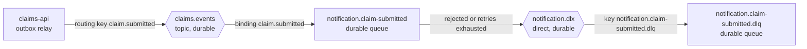

# Event contract: `ClaimSubmitted` v1

This is the contract between claims-api (the producer) and any consumer of claim events, as
promised by [ADR 0005](adr/0005-event-contract-per-service.md). There is no shared library:
each service has its own type for the event, so this document and the two copies of the
fixture file are what keep them in step.

| | |
|---|---|
| Published when | A claim has been accepted: validated, stored, and its outbox row committed |
| Published by | claims-api's outbox relay ([ADR 0002](adr/0002-transactional-outbox.md)) |
| Delivery | At-least-once. The same event can arrive more than once; consumers must de-duplicate on `eventId` ([ADR 0003](adr/0003-at-least-once-idempotent-consumer.md)) |
| Ordering | Not guaranteed, and nothing relies on it |
| Current consumer | notification-service (confirmation email) |

## Message body

`Content-Type: application/json`, UTF-8. Example (the same JSON the tests use, see
[Checked by](#how-the-contract-is-checked)):

```json
{
  "eventId": "6f1c2c1e-6a43-4c1e-9a0b-6e7d3f6c2a10",
  "eventType": "ClaimSubmitted",
  "eventVersion": 1,
  "occurredAt": "2026-10-16T18:04:11.532Z",
  "data": {
    "claimNumber": "HC-2026-000123",
    "policyNumber": "RRM-12345678",
    "policyholder": {
      "firstName": "Jane",
      "lastName": "Doe",
      "email": "jane.doe@example.com"
    },
    "lossType": "WATER",
    "lossDate": "2026-10-12",
    "submittedAt": "2026-10-16T18:04:11.532Z"
  }
}
```

| Field | Type | Notes |
|---|---|---|
| `eventId` | UUID string | Unique per event. Also the AMQP `message_id`. **The de-duplication key.** |
| `eventType` | string | Always `ClaimSubmitted` |
| `eventVersion` | integer | `1`. Also sent as an AMQP header |
| `occurredAt` | ISO-8601 instant, UTC | When the event was created. Today it equals `data.submittedAt` |
| `data.claimNumber` | string | `HC-{year}-{6+ digits}`, e.g. `HC-2026-000123`. Unique |
| `data.policyNumber` | string | `RRM-` plus 8 digits, upper case |
| `data.policyholder.firstName` | string | Trimmed |
| `data.policyholder.lastName` | string | Trimmed |
| `data.policyholder.email` | string | Lower case |
| `data.lossType` | string | `FIRE`, `WATER`, `WIND_HAIL`, `THEFT`, `VANDALISM` or `OTHER` |
| `data.lossDate` | ISO-8601 date | The date the customer entered, with no time zone |
| `data.submittedAt` | ISO-8601 instant, UTC | When the claim was accepted. Up to microsecond precision |

Instants are written by the producer with as many fractional digits as it has (milliseconds in
the fixture, microseconds from the running service). Consumers should parse, not pattern-match.
JSON object key order is not part of the contract: the payload is stored as `jsonb`, which
doesn't keep it.

### What the event leaves out, on purpose

The damage description, the estimated amount, the phone number and the property address are
not in the event. The confirmation email doesn't need them, and every field in a message is
copied to every consumer, the broker's disk, and the dead-letter queue. A consumer that needs
more should ask for it to be added here (an additive change, below) rather than calling the
API back, because the API has no read endpoint by design.

The event does contain personal information (name, email) and the policy number. Treat the
queues like the database: don't log bodies, and restrict who can read them. The services'
own `toString()` methods and log lines only ever print the event ID and claim number.

## AMQP properties and headers

Set by `RabbitEventPublisher` ([source](../claims-api/src/main/java/com/claimsportal/api/infrastructure/RabbitEventPublisher.java)):

| Property / header | Value |
|---|---|
| `message_id` | The `eventId` |
| `type` | `ClaimSubmitted` |
| `content_type` | `application/json` |
| `delivery_mode` | `2` (persistent) |
| header `eventVersion` | `1` (integer) |
| header `traceparent` | W3C trace context, `00-<trace id>-<span id>-<flags>`. Added by Micrometer when the template sends (`spring.rabbitmq.template.observation-enabled`). It carries the **original request's trace ID** through the outbox, so a claim can be followed from the HTTP request to the email ([PLAN section 9](PLAN.md#9-observability)) |

Spring AMQP also adds `spring_returned_message_correlation` and `spring_listener_return_correlation`
headers to match publisher returns to sends. They are not part of the contract; consumers
ignore them. Once a message has been dead-lettered, RabbitMQ adds its own `x-death` and
`x-first-death-*` headers.

Consumers should read the version from the body or the header, not from the AMQP `type`
property, and must not depend on any header other than the ones in the table.

## Routing and topology



| Object | Type | Declared by | Notes |
|---|---|---|---|
| `claims.events` | durable topic exchange | claims-api (the producer owns its exchange) | notification-service declares it too, with identical settings, so it can start first. Declaring an existing exchange with the same settings is a no-op |
| routing key `claim.submitted` | | | One key per event type. The publisher fails the event if it has no key for the type |
| `notification.claim-submitted` | durable queue | notification-service (each consumer owns its queue) | Bound to `claims.events` with `claim.submitted`. `x-dead-letter-exchange` = `notification.dlx`, `x-dead-letter-routing-key` = `notification.claim-submitted.dlq` |
| `notification.dlx` | durable direct exchange | notification-service | |
| `notification.claim-submitted.dlq` | durable queue | notification-service | Bound to `notification.dlx` with its own name. Holds messages that failed ([ADR 0004](adr/0004-retry-and-dead-letter.md)) |

A new consumer declares its own durable queue and binds it to `claims.events` with
`claim.submitted` (or a pattern such as `claim.*`). Nothing changes in claims-api.

The producer publishes with `mandatory` set and waits for the broker's confirm. A message that
matches no queue is **returned**, not silently dropped, and the outbox row stays pending until
a queue is bound. So at least one consumer queue must exist for events to be marked published.

## Consumer behaviour (notification-service)

- **De-duplication:** the first step inside the consumer's transaction is
  `INSERT … ON CONFLICT (event_id) DO NOTHING` on `eventId`. A duplicate is acknowledged and skipped.
- **Tolerant reader:** it declares only the fields it uses and ignores unknown ones.
  Required: `eventId`, `eventType`, `eventVersion`, `data.claimNumber`, `data.policyNumber`,
  `data.policyholder.firstName`, `data.policyholder.email`, `data.lossType`, `data.lossDate`.
- **Unsupported or invalid events** (unparseable JSON, another `eventType`, an `eventVersion`
  other than 1, a missing required field) are **not retried**. They go straight to the DLQ,
  where they wait for a fix and a replay.
- **Transient failures** (e.g. the SMTP server is down) are retried 4 times in all with
  exponential back-off, then dead-lettered ([ADR 0004](adr/0004-retry-and-dead-letter.md)).

## Versioning rules

1. **Additive changes stay in v1.** A new optional field in `data` (or at the top level) doesn't
   change `eventVersion`. Consumers must ignore fields they don't know. Producers must not
   remove or change the meaning of a field to do this.
2. **Breaking changes are a new version.** Removing or renaming a field, changing a type or
   its meaning, or making an optional field required publishes `eventVersion: 2`. The
   producer sends **both** v1 and v2 until every consumer has moved, then retires v1. How the
   two travel (a second routing key such as `claim.submitted.v2`, or a version in the body of
   the same key) is decided when it happens, and recorded in an ADR.
3. **A consumer that gets a version it doesn't know sends it to the DLQ** rather than guessing.
   After the consumer is upgraded, the messages can be replayed ([ADR 0004](adr/0004-retry-and-dead-letter.md)).
4. **Event IDs are never reused.** A replayed message keeps its `eventId`, which is why replaying
   twice by mistake only sends one email.

## How the contract is checked

- `claims-api/src/test/resources/contracts/claim-submitted-v1.json` is the producer's fixture.
  `OutboxPublishingIntegrationTest` publishes a claim through a real RabbitMQ container,
  checks the AMQP properties, the `eventVersion` header, the exchange and the routing key, and
  compares the body with the fixture strictly (no missing or extra fields; the values that differ
  per claim, such as the event ID, claim number and dates, only have to have the right format).
  `RabbitEventPublisherTest` checks the properties without a broker.
- `notification-service/src/test/resources/contracts/claim-submitted-v1.json` is a copy. `ClaimSubmittedContractTest`
  parses it, and also parses it with an extra unknown field to prove the tolerant reader.
- The two fixtures must be identical. That is manual today: change one, change the other.
  Consumer-driven contract tests (Pact) or a schema registry would automate it ([ADR 0005](adr/0005-event-contract-per-service.md)).
